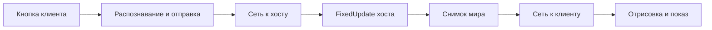

# Разбор проблем клиента и задержки

Обновление: для оставшихся проблем интерфейса и музыки после повтора босса подготовлена
[версия 0.1.6](client-fixes-0.1.6-ru.md). Ранее подготовлена [версия 0.1.5](client-fixes-0.1.5-ru.md),
проверенная в двух запущенных копиях игры. Ниже сохранён исходный аудит и границы проверки версии 0.1.4.

Проверено 8 ноября 2026 года: исходники мода 0.1.3 и DLL установленной игры из
`F:\Games\Cuphead\Cuphead_Data\Managed`. Подготовлена сборка 0.1.4, протокол 4.
Исправления собраны, но визуальные и звуковые результаты в двух запущенных играх ещё не проверялись.
Сборка не устанавливалась в игру автоматически.

## Что обнаружено и изменено

| Симптом | Найденный дефект | Изменение и степень подтверждения |
|---|---|---|
| Текст выглядит как каракули | При обновлении материала TMP проверялась только ненулевая текстура, без проверки соответствия атласу текущего шрифта. Материал назначался перед шрифтом. Поздние определения шрифта не имели отдельной повторной привязки. | Шрифт назначается первым, TMP принимает только материал с соответствующим атласом, обычный Unity Text использует материал своего шрифта. Не найденные шрифты и материалы повторно разрешаются. Дефекты кода подтверждены; точное соответствие вашему изображению требует проверки в игре. |
| Не видно меню управления хоста | `CaptureGraphics` отбрасывал Canvas вне активной сцены. ControlMapper находится под постоянным объектом Cuphead в `DontDestroyOnLoad`. В `OptionsGUI.ShowControlMapper` обычное меню скрывается перед открытием ControlMapper. | Добавлен захват постоянных Canvas и поиск подходящих постоянных UI-камер. Это объясняет исчезновение меню целиком. Визуальная проверка остаётся. |
| После подключения нет музыки мира | `AudioSync` передавал события, происходящие только при уже подключённом клиенте. Запущенная ранее музыка отсутствовала в начальном состоянии. Кроме того, autoplay в `AudioManagerComponent` идёт напрямую из события загрузчика. | Новый `MusicSync` после `SceneReady` передаёт состояние BGM, альтернативных треков и плейлиста: играет ли источник, клип, позицию, цикл, громкость и pitch. Клиент ждёт завершения загрузки, повторяет поиск отложенных клипов и выводит предупреждение, если источник не появился за 5 секунд. Восстанавливается выход из состояния микшера Loadscreen. Логика проверена автоматическими тестами с заменителями движка. |
| Теряются рывок и смена оружия | В `VirtualPad.Edges.Advance` после перерыва опроса физики больше 250 мс все последние счётчики принимались за уже обработанные. Вместе со старыми нажатиями удалялось и свежее. Оба действия игра читает через `GetButtonDown` в `FixedUpdate`: Dash — action 7, SwitchWeapon — action 5. | Теперь возраст определяется для каждого нажатия по времени его получения. Свежее нажатие переживает паузу в опросе; старое из меню истекает. Добавлены восстановление счётчика по переходу удержания и диагностика в F8. Ошибка воспроизведена тестом. Постоянный отказ действий на протяжении всей сессии этим ещё не доказан. |

Изменённые участки: `src/Sync/ClientMirror.cs`, `HostSync.cs`, `RemoteInput.cs`, новый `MusicSync.cs`,
`src/Plugin.cs`, `src/Net/Session.cs`, `Protocol.cs`, `src/UI/Overlay.cs`.

В TMP геометрия символов и материал должны использовать один атлас; это согласуется с устройством
[Font Asset в документации Unity](https://docs.unity.cn/Packages/com.unity.textmeshpro%403.2/manual/FontAssetsProperties.html).
Здесь дополнительно проверена реализация старого TMP из DLL самой установленной игры.

## Почему собственное переназначение клиента — отдельная задача

Мод передаёт уже распознанные **действия**, а не физические клавиши: клиентский Rewired player 0 → сеть →
виртуальный Rewired player 1 хоста. Открытое хостом меню меняет привязки на компьютере хоста.
Оно не может изменить, какая клавиша на компьютере клиента превращается в действие Dash.

Исправление захвата делает меню хоста видимым. Оно **не добавляет собственный локальный ControlMapper клиенту**.
Для полноценной настройки во время соединения требуется отдельный локальный режим настроек: свой Canvas и
EventSystem, разрешение ввода только для этого интерфейса и нейтральный ввод на хосте на время переназначения.
Сейчас надёжный способ — настроить локального игрока 1 до подключения, как вы уже проверили.

Есть и дополнительный пробел для интерактивности зеркального меню: мод перехватывает `Player.GetButton*/GetAxis(int)`,
тогда как Rewired UI-модуль использует строковые перегрузки, `GetAxisRaw(string)` и
`GetNegativeButtonDown(string)`. Передача изображения меню сама по себе не гарантирует навигацию по нему
удалённым контроллером. Это осталось за пределами данной правки; переадресовывать физические переназначения
клиента в меню хоста было бы неверно.

## Если рывок или смена оружия всё равно не работают

В F8 теперь показаны счётчики `Sent input: Dash=..., Switch=...` у клиента и `Received input` / `Physics edges`
у хоста. Счётчики передаваемых нажатий байтовые: после 255 переходят в 0. Сравнивать нужно их изменение,
а не абсолютное равенство со счётчиками физических шагов.

1. Если счётчик клиента не меняется при нажатии, действие не распознано до сети. Проверять привязки и
   назначение устройства локальному Rewired player 0. Исправление сетевой задержки здесь не поможет.
2. Если у клиента меняется, а у хоста нет — проверять доставку Input, состояние соединения и логи.
3. Если Received меняется, а Physics edges нет — проверять паузу, загрузку и обработку фиксированного шага.
4. Если оба меняются, но действия нет — проверять игровое состояние персонажа. Например, смена оружия
   требует второго оружия в **экипировке игрока 2 хоста**; имеются также ограничения от амулетов и состояния персонажа.

Без такой проверки нельзя честно утверждать, что найденная ошибка с первым нажатием объясняет любой постоянный отказ.

## Откуда берётся задержка

Клиент не симулирует своего персонажа. Реакция на собственное нажатие проходит полный путь:



Поэтому задержка видимой реакции приблизительно равна **RTT + ожидание игровых шагов и показа**.
«Половина пинга» описывает только одно направление. При RTT 60 мс нельзя получить подтверждённую хостом
реакцию на нажатие за 30 мс. При 60 FPS одна дополнительная граница кадра стоит до примерно 16,7 мс;
отдельно влияет период физики и очередь показа.

В исходной версии приём шёл в `Plugin.Update`, хотя физика этого кадра могла уже завершиться, а отправка
клиентского ввода ждала `WaitForEndOfFrame`. Порядок физических и кадровых событий описан в
[документации Unity 2017.4](https://docs.unity3d.com/2017.4/Documentation/Manual/ExecutionOrder.html).

В подготовленной правке:

- Плагин получает ранний порядок выполнения `DefaultExecutionOrder(-10000)`.
- Хост дополнительно принимает пакеты перед своими игровыми `FixedUpdate`.
- Клиент опрашивает и отправляет ввод в `LateUpdate`, после кадрового обновления ввода и до отрисовки.
- Клиент дополнительно принимает снимки в `LateUpdate`, чтобы доступные пакеты успели попасть в текущую отрисовку.
- Снимок хоста продолжает захватываться после отрисовки: существующий захват использует окончательные трансформы
  и `Renderer.isVisible`. Его перенос раньше без переработки определения видимости требует отдельной проверки.

Это сокращает ожидания внутри кадра, но не уменьшает сетевой RTT. Реальный выигрыш в миллисекундах не измерялся.
Зависимость от порядка выполнения Rewired, частоты физики и VSync нужно проверить в игре, а не только сборкой.

## Что оптимизировать дальше, по приоритету

1. **Измерения всей цепочки.** Добавить номер входного пакета, впервые использованного физикой, в ответный снимок.
   На клиенте измерять время от отправки до отрисовки соответствующего результата. Нужны медиана и p95/p99,
   время `CaptureRenderers/CaptureGraphics`, размер очередей и оценка потерь. Текущий сглаженный RTT в F8 —
   не измерение задержки кнопка → экран.
2. **Устойчивость дельт к потерям.** Снимки сравниваются с последним отправленным состоянием, а не с подтверждённым
   клиентом. У Sprite/UI полный периодический повтор сейчас выбирается только при `mask == 0`. Непрерывно
   меняющийся объект может долго не получить полный повтор после потери отдельного поля. Кроме того,
   `LastFrame` отбрасывает старый пакет целиком даже с полем, отсутствовавшим в новом. Это риск визуальных ошибок
   и скачков; нужна независимая периодическая полная синхронизация либо дельты от подтверждённой базы.
3. **Стоимость захвата и сборщик мусора.** `FindObjectsOfType` для спрайтов, масок и Canvas выполняется каждый кадр;
   есть массивы и копии пакетов `ToArray`. Имеет смысл профилировать и затем заменить полные обходы реестрами
   объектов, а частые выделения — переиспользованием буферов. Польза прежде всего в стабильности кадров и p99.
4. **Приоритет трафика и загрузка канала.** `Connection.Flush` сначала отправляет до 32 KiB надёжных сообщений,
   затем ненадёжные снимки. Большой поток определений/повторов может ухудшить время доставки снимков при
   заполненном канале. Сами снимки не ждут надёжного порядка на приёме; общий надёжный порядок блокирует
   следующие аудиособытия/определения при пропуске одного из них. Нужны приоритеты и ограничение нагрузки,
   опирающиеся на измерения.
5. **Частота и маршрут.** `SendInterval=1` даёт минимальное ожидание очередного снимка при достаточной пропускной
   способности. `2` экономит upload, но увеличивает интервал. Сравнивать прямой UDP и Steam следует по реальному
   RTT, потерям и стабильности у вашей пары компьютеров: прямое соединение не всегда быстрее.
6. **Транспорт Steam.** Используемый `ISteamNetworking` — старый интерфейс; Valve рекомендует новые API.
   Миграция требует проверки доступных DLL/обёрток этой версии игры. Простая замена Unreliable на NoDelay
   не является универсальным исправлением: NoDelay отбрасывает пакеты, пока сессия ещё не установлена.
   Источник: [Steamworks ISteamNetworking](https://partner.steamgames.com/doc/api/ISteamNetworking).
7. **Предсказание локального персонажа.** Для субъективно более быстрой реакции потребуется клиентское
   предсказание с коррекцией по хосту. Это крупное изменение текущего зеркала: нужны движение, столкновения,
   рывок и правила коррекции. Простая экстраполяция спрайта не предсказывает попадания и может показывать
   невозможные действия. Полный rollback всего мира потребует решения проблемы случайности и состояния боссов.

Практический предел текущей архитектуры — устранить лишние очереди и держать стабильный кадр.
Скрыть RTT для собственных действий без предсказания она не может. Интерполяция способна сгладить рывки,
но добавляет ожидание и сама по себе не уменьшает задержку управления.

## Что проверено

```powershell
dotnet build -c Release -p:GameManaged=F:/Games/Cuphead/Cuphead_Data/Managed
dotnet run --project tools/SyncCheck/SyncCheck.csproj -c Release
git diff --check
```

Сборка проходит без предупреждений и ошибок. HookCheck проверил 15 целей Harmony и 16 отражаемых членов;
3 поиска с динамическим типом остаются вне статической проверки. Проверка наличия целей не подтверждает
порядок выполнения или поведение хуков в запущенной Unity.

SyncCheck выполняет 27 проверок, включая независимые края Update/FixedUpdate, свежее нажатие после паузы,
истечение старого нажатия, короткий тап, потерянный отпуск, переполнение счётчика/sequence, сброс зависшего
удержания, резервное распознавание нажатия, дробление музыкального состояния по MTU, переупорядочивание
надёжных пакетов, ожидание загрузчика, поздний клип, восстановление позиции/громкости и остановленный трек.
Тесты используют настоящий код синхронизации и транспорта сообщений, но Unity/Rewired/Harmony заменены
минимальными тестовыми классами. Они не проверяют рендеринг шрифтов или реальное воспроизведение звука.

## Проверка на двух компьютерах перед использованием сборки

На обеих сторонах требуется одна версия 0.1.4 / протокол 4. Готовая DLL:
`bin/Release/net35/CupheadOnline.dll`.

- Подключиться к хосту, который уже несколько секунд стоит на карте. Проверить музыку сразу после загрузки,
  затем повторить вход при паузе, после смены музыкальной области и после переподключения.
- Проверить текст обычного меню, диалогов, паузы, кириллицу и переходы между сценами, в том числе при разных
  разрешениях сторон. Проверить меню управления, открытое хостом. Собственный ControlMapper клиента пока
  проверять до подключения — отдельный интерфейс во время соединения не реализован.
- На клавиатуре и геймпаде проверить короткие и удерживаемые рывки, смену оружия, прыжок и EX, затем повторить
  после паузы и входа к боссу. При отказе записать изменение счётчиков F8 с обеих сторон.
- Отдельно проверить игру при потере/перестановке пакетов и сравнить задержку с исходной 0.1.3 на одинаковом
  маршруте и настройках. Реальная проверка этих сценариев ещё не выполнялась.

Ограничения музыкального восстановления: позиция оценивается приблизительно; для отдельных форматов seek
может не поддерживаться. Это начальное восстановление состояния, а не непрерывная синхронизация DSP-часов,
микшерных переходов и курсора плейлиста. Специальные звуки вне перечисленных BGM-источников остаются за его рамками.
